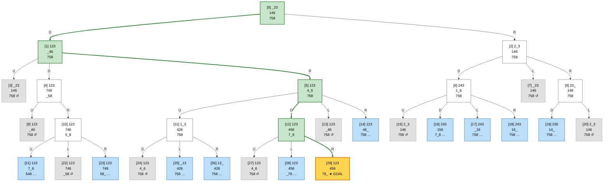
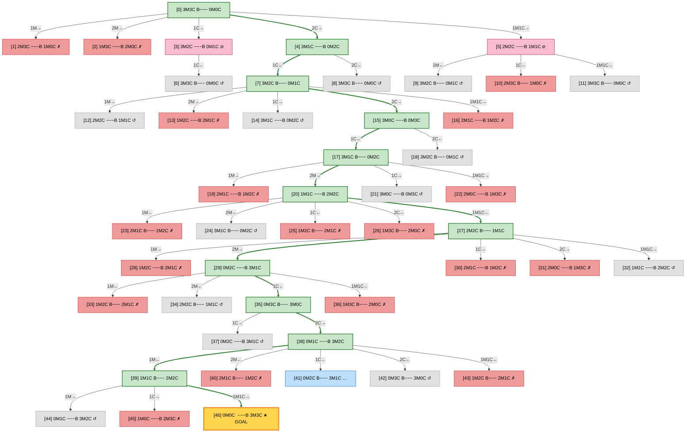
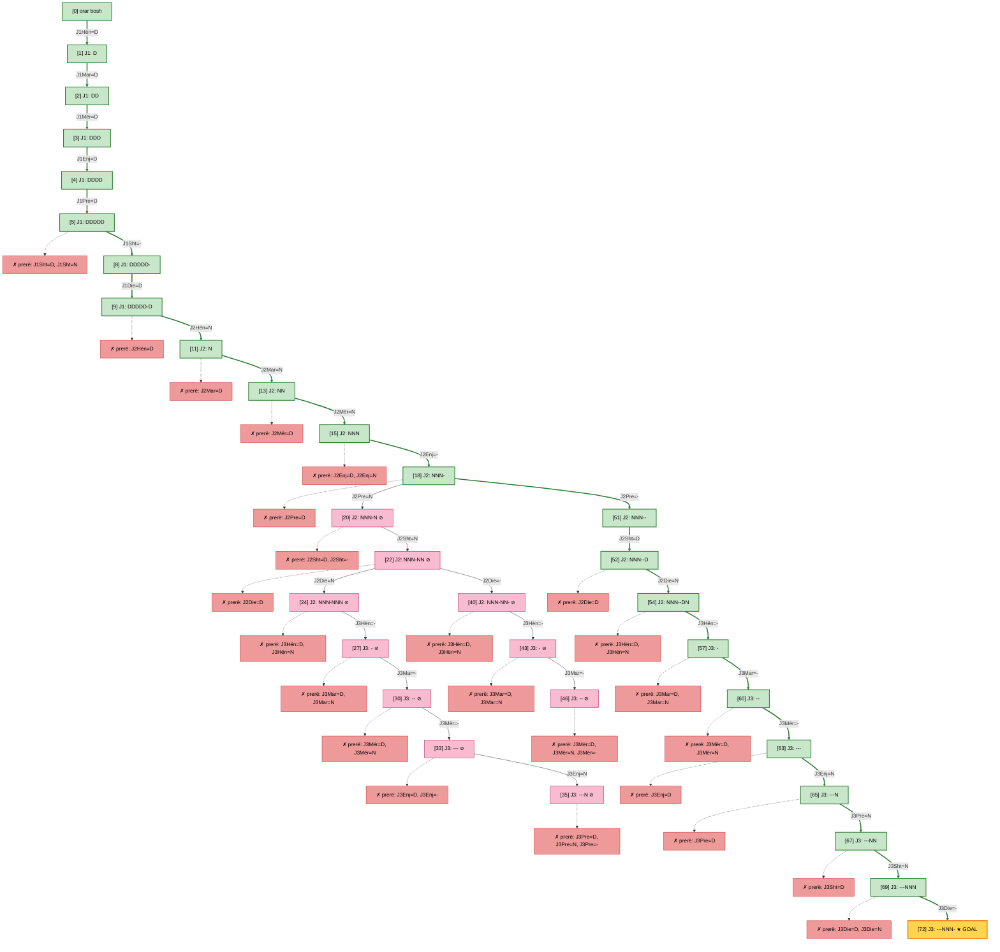

# Detyra 4 – Search Trees (8-Puzzle, Missionaries and Cannibals, Rotating Workforce Scheduling, C#)

## Ekzekutimi
```bash
cd Detyra4-SearchTrees
dotnet run -c Release -- all                 # të tri pemët
dotnet run -c Release -- puzzle              # 8-Puzzle me gjendjen default 023146758
dotnet run -c Release -- puzzle 413026758    # 8-Puzzle me gjendje të çfarëdoshme (0 = vendi bosh)
dotnet run -c Release -- mc                  # Missionaries and Cannibals
dotnet run -c Release -- rws                 # Rotating Workforce Scheduling
dotnet run -c Release -- rws --full          # pa i grupuar fëmijët e prerë
dotnet run -c Release -- all --dot           # ruan pemët edhe si Graphviz në output/*.dot
dotnet run -c Release -- all --mermaid       # ruan pemët edhe si diagrame Mermaid në output/*.mmd
```

## Si ndërtohet pema e kërkimit
Çdo problem e implementon të njëjtin interface `IProblem<S>`: gjendja fillestare, `Successors(s)`
(veprimi, gjendja e re dhe a është ajo valide), goal test-i dhe çelësi i gjendjes. `SearchTree<S>`
e ndërton pemën duke e ruajtur çdo nyje me prindin, veprimin, thellësinë dhe fëmijët. Pastaj e printon
në ASCII dhe, sipas dëshirës, si Graphviz ose Mermaid (shih [Diagramet](#diagramet-e-pemëve-mermaid)).

| Simboli | Kuptimi |
|---|---|
| `★ GOAL` | nyja që e plotëson goal test-in |
| `◄` | nyja është në rrugën nga rrënja te goal-i |
| `↺` | gjendje që është parë më herët, nuk zgjerohet (ndryshe pema do të ishte e pafundme) |
| `✗` | gjendje jo-valide, shkel kufizimet dhe pritet |
| `⊘` | dead-end: u zgjerua, por nuk ka asnjë vazhdim valid (backtrack) |
| `…` | në frontier: u gjenerua, por kërkimi mbaroi para se të zgjerohej |

- **BFS (8-Puzzle, M&C):** nyjet zgjerohen nivel pas niveli me radhë FIFO. Goal test-i bëhet kur nyja
  gjenerohet. Gjendjet e përsëritura kontrollohen me një `HashSet` (graph search). Meqë kostoja e çdo
  veprimi është 1, zgjidhja që gjendet është ajo me numrin më të vogël të hapave.
- **DFS me backtracking (RWS):** problemi është CSP dhe të gjitha zgjidhjet janë në thellësinë
  `d = 7n`, prandaj BFS-ja do t'i mbante në memorie të gjitha orarët e pjesshëm. DFS-ja zgjeron fëmijën
  e parë valid dhe kthehet mbrapa kur nyja nuk ka vazhdim.

---

## 1. 8-Puzzle
- **Gjendja:** grid 3×3 me pllakat 1..8 dhe vendin bosh, e ruajtur si string me 9 karaktere (`0` = bosh).
  Në pemë shfaqet si `abc|def|ghi`.
- **Gjendja fillestare:** `_23|146|758`. **Goal:** `123|456|78_`.
- **Veprimet:** vendi bosh lëviz `U`, `D`, `L` ose `R`, nëse nuk del nga grid-i. Kostoja e çdo veprimi është 1.
- **Landscape:** `9! = 362,880` rregullime, prej të cilave vetëm `9!/2 = 181,440` janë të arritshme
  (pariteti i inversioneve). Faktori i degëzimit është `b ∈ {2, 3, 4}`. Programi i refuzon gjendjet e
  pazgjidhshme që para kërkimit.

```
[0] _23|146|758 ◄
├── D → [1] 123|_46|758 ◄
│   ├── U → [3] _23|146|758 ↺
│   ├── D → [4] 123|746|_58
│   │   ├── U → [9] 123|_46|758 ↺
│   │   └── R → [10] 123|746|5_8
│   │       ├── U → [21] 123|7_6|548 …
│   │       ├── L → [22] 123|746|_58 ↺
│   │       └── R → [23] 123|746|58_ …
│   └── R → [5] 123|4_6|758 ◄
│       ├── U → [11] 1_3|426|758
│       │   ├── D → [24] 123|4_6|758 ↺
│       │   ├── L → [25] _13|426|758 …
│       │   └── R → [26] 13_|426|758 …
│       ├── D → [12] 123|456|7_8 ◄
│       │   ├── U → [27] 123|4_6|758 ↺
│       │   ├── L → [28] 123|456|_78 …
│       │   └── R → [29] 123|456|78_ ★ GOAL
│       ├── L → [13] 123|_46|758 ↺
│       └── R → [14] 123|46_|758 …
└── R → [2] 2_3|146|758
    ├── D → [6] 243|1_6|758
    │   ├── U → [15] 2_3|146|758 ↺
    │   ├── D → [16] 243|156|7_8 …
    │   ├── L → [17] 243|_16|758 …
    │   └── R → [18] 243|16_|758 …
    ├── L → [7] _23|146|758 ↺
    └── R → [8] 23_|146|758
        ├── D → [19] 236|14_|758 …
        └── L → [20] 2_3|146|758 ↺
```
**Zgjidhja:** `D R D R` (4 hapa). U gjeneruan 30 nyje dhe u zgjeruan 10.

## 2. Missionaries and Cannibals
- **Gjendja:** `(M, C, B)`: misionarët dhe kanibalët në bregun e majtë, dhe në cilin breg është varka.
  Në pemë shfaqet si `3M3C B~~~  0M0C` (bregu i majtë, lumi, bregu i djathtë).
- **Gjendja fillestare:** `(3, 3, majtas)`. **Goal:** `(0, 0, djathtas)`.
- **Veprimet:** varka me kapacitet 2 kalon me `1M`, `2M`, `1C`, `2C` ose `1M1C`
  (`→` nga e majta në të djathtë, `←` anasjelltas). Kostoja e çdo veprimi është 1.
- **Kufizimi:** në asnjë breg misionarët nuk mund të jenë më pak se kanibalët, përveç kur nuk ka misionarë.
  Gjendjet që e shkelin këtë shfaqen në pemë si `✗`.
- **Landscape:** `4·4·2 = 32` gjendje teorike. 20 prej tyre janë të sigurta dhe 16 janë të arritshme
  nga gjendja fillestare.

```
[0] 3M3C B~~~  0M0C ◄
├── 1M→ → [1] 2M3C  ~~~B 1M0C ✗
├── 2M→ → [2] 1M3C  ~~~B 2M0C ✗
├── 1C→ → [3] 3M2C  ~~~B 0M1C ⊘
│   └── 1C← → [6] 3M3C B~~~  0M0C ↺
├── 2C→ → [4] 3M1C  ~~~B 0M2C ◄
│   ├── 1C← → [7] 3M2C B~~~  0M1C ◄
│   │   ├── 1M→ → [12] 2M2C  ~~~B 1M1C ↺
│   │   ├── 2M→ → [13] 1M2C  ~~~B 2M1C ✗
│   │   ├── 1C→ → [14] 3M1C  ~~~B 0M2C ↺
│   │   ├── 2C→ → [15] 3M0C  ~~~B 0M3C ◄
│   │   │   ├── 1C← → [17] 3M1C B~~~  0M2C ◄
│   │   │   │   ├── 1M→ → [19] 2M1C  ~~~B 1M2C ✗
│   │   │   │   ├── 2M→ → [20] 1M1C  ~~~B 2M2C ◄
│   │   │   │   │   ├── 1M← → [23] 2M1C B~~~  1M2C ✗
│   │   │   │   │   ├── 2M← → [24] 3M1C B~~~  0M2C ↺
│   │   │   │   │   ├── 1C← → [25] 1M2C B~~~  2M1C ✗
│   │   │   │   │   ├── 2C← → [26] 1M3C B~~~  2M0C ✗
│   │   │   │   │   └── 1M1C← → [27] 2M2C B~~~  1M1C ◄
│   │   │   │   │       ├── 1M→ → [28] 1M2C  ~~~B 2M1C ✗
│   │   │   │   │       ├── 2M→ → [29] 0M2C  ~~~B 3M1C ◄
│   │   │   │   │       │   ├── 1M← → [33] 1M2C B~~~  2M1C ✗
│   │   │   │   │       │   ├── 2M← → [34] 2M2C B~~~  1M1C ↺
│   │   │   │   │       │   ├── 1C← → [35] 0M3C B~~~  3M0C ◄
│   │   │   │   │       │   │   ├── 1C→ → [37] 0M2C  ~~~B 3M1C ↺
│   │   │   │   │       │   │   └── 2C→ → [38] 0M1C  ~~~B 3M2C ◄
│   │   │   │   │       │   │       ├── 1M← → [39] 1M1C B~~~  2M2C ◄
│   │   │   │   │       │   │       │   ├── 1M→ → [44] 0M1C  ~~~B 3M2C ↺
│   │   │   │   │       │   │       │   ├── 1C→ → [45] 1M0C  ~~~B 2M3C ✗
│   │   │   │   │       │   │       │   └── 1M1C→ → [46] 0M0C  ~~~B 3M3C ★ GOAL
│   │   │   │   │       │   │       ├── 2M← → [40] 2M1C B~~~  1M2C ✗
│   │   │   │   │       │   │       ├── 1C← → [41] 0M2C B~~~  3M1C …
│   │   │   │   │       │   │       ├── 2C← → [42] 0M3C B~~~  3M0C ↺
│   │   │   │   │       │   │       └── 1M1C← → [43] 1M2C B~~~  2M1C ✗
│   │   │   │   │       │   └── 1M1C← → [36] 1M3C B~~~  2M0C ✗
│   │   │   │   │       ├── 1C→ → [30] 2M1C  ~~~B 1M2C ✗
│   │   │   │   │       ├── 2C→ → [31] 2M0C  ~~~B 1M3C ✗
│   │   │   │   │       └── 1M1C→ → [32] 1M1C  ~~~B 2M2C ↺
│   │   │   │   ├── 1C→ → [21] 3M0C  ~~~B 0M3C ↺
│   │   │   │   └── 1M1C→ → [22] 2M0C  ~~~B 1M3C ✗
│   │   │   └── 2C← → [18] 3M2C B~~~  0M1C ↺
│   │   └── 1M1C→ → [16] 2M1C  ~~~B 1M2C ✗
│   └── 2C← → [8] 3M3C B~~~  0M0C ↺
└── 1M1C→ → [5] 2M2C  ~~~B 1M1C ⊘
    ├── 1M← → [9] 3M2C B~~~  0M1C ↺
    ├── 1C← → [10] 2M3C B~~~  1M0C ✗
    └── 1M1C← → [11] 3M3C B~~~  0M0C ↺
```
**Zgjidhja (11 kalime):** `2C→ 1C← 2C→ 1C← 2M→ 1M1C← 2M→ 1C← 2C→ 1M← 1M1C→`.
Pema ka 47 nyje: 18 jo-valide, 14 të përsëritura dhe 2 dead-end. Pema është e ngushtë, sepse
kufizimi i sigurisë i pret shumicën e veprimeve.

## 3. Rotating Workforce Scheduling
- **Problemi:** duhet një orar ciklik për `n` punëtorë: një matricë `n × 7`, ku rreshti `j` është java `j`
  e ciklit. Punëtori që e fillon një javë, javën tjetër vazhdon me rreshtin e radhës, dhe pas rreshtit të
  fundit kthehet te i pari. Prandaj i gjithë orari lexohet si një sekuencë ciklike me `7n` ditë.
- **Instanca:** `n = 3`, ndërrimet `D` (ditë), `N` (natë) dhe `-` (pushim). Çdo ditë duhen 1 `D` dhe
  1 `N`, prandaj mbetet 1 pushim.
- **Kufizimet:**
  1. kërkesa ditore: në secilën kolonë (ditë të javës) ka saktësisht 1 `D` dhe 1 `N`;
  2. blloku i ditëve të punës ka gjatësi `2..5`, dhe blloku i pushimit `1..3`;
  3. jo më shumë se 3 netë rresht;
  4. sekuenca `N → D` është e ndaluar (pas natës nuk mund të vijë direkt ndërrimi i ditës);
  5. kufizimet 2–4 vlejnë edhe në kalimin nga java e fundit te java e parë.
- **Variablat:** `x[j][d]` për `j ∈ 1..3`, `d ∈ Hën..Die`, pra 21 variabla. **Domain:** `{D, N, -}`.
- **Veprimi:** i cakton vlerë slot-it të radhës të pacaktuar (java pas jave, ditë pas dite).
  Fëmijët që shkelin një kufizim shënohen `✗`. Në pemë ata grupohen në një rresht `✗ prerë: …`
  (`--full` i shfaq një nga një).
- **Landscape:** `3^21 ≈ 1.05·10^10` orare. Nëse çdo kolonë është permutacion i `{D, N, -}`
  (kërkesa ditore), mbeten `6^7 = 279,936`. Thellësia e zgjidhjes është `d = 21` dhe `b ≤ 3`.

```
[0] orar bosh ◄
└── J1Hën=D → [1] J1: D ◄
    └── J1Mar=D → [2] J1: DD ◄
        └── J1Mër=D → [3] J1: DDD ◄
            └── J1Enj=D → [4] J1: DDDD ◄
                └── J1Pre=D → [5] J1: DDDDD ◄
                    ├── ✗ prerë: J1Sht=D, J1Sht=N
                    └── J1Sht=- → [8] J1: DDDDD- ◄
                        └── J1Die=D → [9] J1: DDDDD-D ◄
                            ├── ✗ prerë: J2Hën=D
                            └── J2Hën=N → [11] J2: N ◄
                                ├── ✗ prerë: J2Mar=D
                                └── J2Mar=N → [13] J2: NN ◄
                                    ├── ✗ prerë: J2Mër=D
                                    └── J2Mër=N → [15] J2: NNN ◄
                                        ├── ✗ prerë: J2Enj=D, J2Enj=N
                                        └── J2Enj=- → [18] J2: NNN- ◄
                                            ├── ✗ prerë: J2Pre=D
                                            ├── J2Pre=N → [20] J2: NNN-N ⊘
                                            │   ├── ✗ prerë: J2Sht=D, J2Sht=-
                                            │   └── J2Sht=N → [22] J2: NNN-NN ⊘
                                            │       ├── ✗ prerë: J2Die=D
                                            │       ├── J2Die=N → [24] J2: NNN-NNN ⊘
                                            │       │   └── ...  (dead-end, backtrack)
                                            │       └── J2Die=- → [40] J2: NNN-NN- ⊘
                                            │           └── ...  (dead-end, backtrack)
                                            └── J2Pre=- → [51] J2: NNN-- ◄
                                                └── J2Sht=D → [52] J2: NNN--D ◄
                                                    ├── ✗ prerë: J2Die=D
                                                    └── J2Die=N → [54] J2: NNN--DN ◄
                                                        └── J3Hën=- → J3Mar=- → J3Mër=- → J3Enj=N
                                                            → J3Pre=N → J3Sht=N → J3Die=- ★ GOAL
```
(Pema e plotë, me 73 nyje, printohet nga programi.) Dega `J2Pre=N` mbaron në dead-end, sepse java 3
nuk mund të plotësohet pa i shkelur kufizimet. DFS-ja kthehet mbrapa te nyja `[18]` dhe provon `J2Pre=-`.

**Orari i gjetur:**
```
        Hën Mar Mër Enj Pre Sht Die
Java 1:  D   D   D   D   D   -   D
Java 2:  N   N   N   -   -   D   N
Java 3:  -   -   -   N   N   N   -
```

## Diagramet e pemëve (Mermaid)
GitHub i shfaq diagramet më poshtë direkt në README. Programi i gjeneron me
`dotnet run -c Release -- all --mermaid` (skedarët `output/*.mmd`).

| Ngjyra | Kuptimi |
|---|---|
| 🟩 e gjelbër, shigjetë e trashë | rruga nga rrënja te goal-i |
| 🟨 e verdhë | goal |
| ⬜ e bardhë | nyje e zgjeruar jashtë rrugës së zgjidhjes |
| 🟥 e kuqe | gjendje jo-valide (prerë) |
| ◻️ gri | gjendje e përsëritur (nuk zgjerohet) |
| 🟪 rozë | dead-end (backtrack) |
| 🟦 blu | në frontier (e pazgjeruar) |

### 8-Puzzle (BFS)


### Missionaries and Cannibals (BFS)


### Rotating Workforce Scheduling (DFS me backtracking)
Fëmijët e prerë të çdo nyjeje janë bashkuar në një nyje të kuqe, të lidhur me vijë të ndërprerë.



## Rezultatet
| Problemi | Strategjia | Nyje të gjeneruara | Të zgjeruara | Thellësia e zgjidhjes |
|---|---|---|---|---|
| 8-Puzzle (`023146758`) | BFS | 30 | 10 | 4 |
| 8-Puzzle (`413026758`) | BFS | 54 | 20 | 5 |
| Missionaries and Cannibals | BFS | 47 | 13 | 11 |
| Rotating Workforce (n = 3) | DFS + backtracking | 73 | 31 | 21 |
